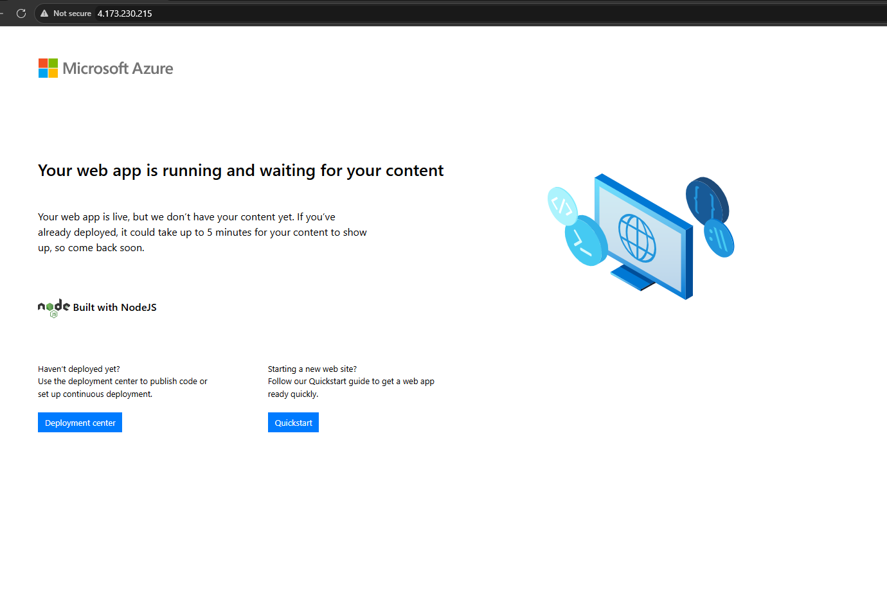
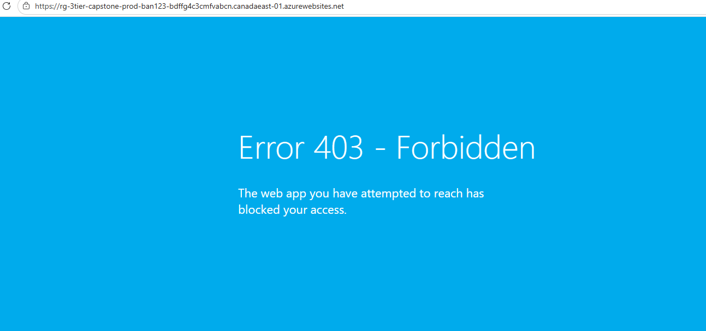
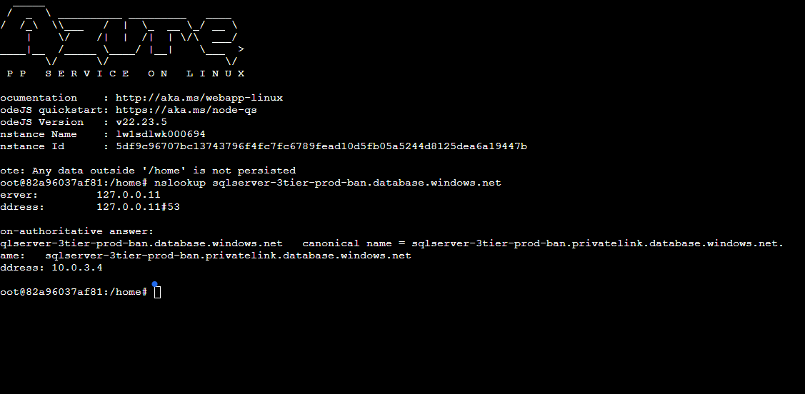
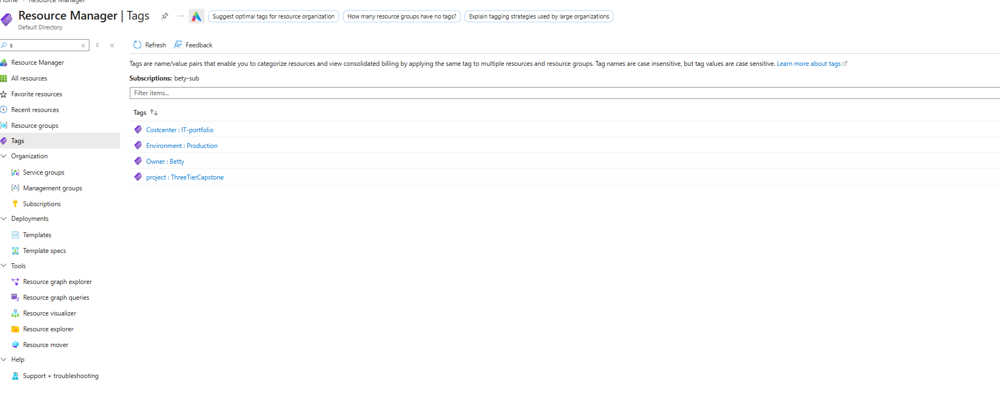
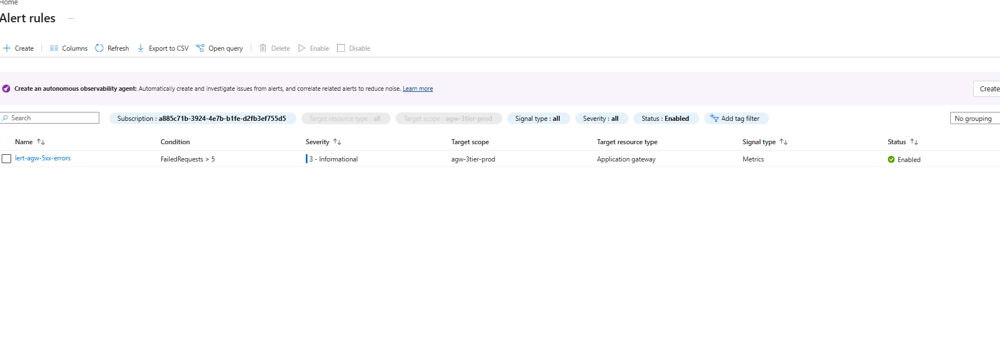

# Enterprise 3-Tier Secure Web Architecture on Microsoft Azure


## Project Overview
This capstone project demonstrates the design, deployment, and security hardening of a **Zero Trust 3-tier web application architecture** on Microsoft Azure. The environment isolates the compute and data layers from the public internet using network segmentation, Web Application Firewall (WAF) ingress filtering, Cross-Region Global VNet Peering, Private Endpoints, Private DNS, RBAC governance, automated backup retention, and centralized Azure Monitor logging.

---

## Architecture Diagram

```text
                         [ Public Internet User ]
                                    │
                                    ▼ (HTTP :80)
┌───────────────────────────────────────────────────────────────────────────┐
│  REGION 1: Canada Central (Vnet-3tier-prod: 10.0.0.0/16)                  │
│                                                                           │
│  ┌─────────────────────────────────────────────────────────────────────┐  │
│  │  TIER 1: Ingress & WAF (snet-appgw: 10.0.1.0/24 | nsg-appgw)        │  │
│  │  • Azure Application Gateway (WAF_v2 - OWASP 3.2)                   │  │
│  │  • Static Public IP: 4.173.230.215                                  │  │
│  └──────────────────────────────────┬──────────────────────────────────┘  │
│                                     │ (Encrypted HTTPS :443)              │
│                                     │ (Direct Public Access = 403 Denied) │
└─────────────────────────────────────┼─────────────────────────────────────┘
                                      ▼
┌───────────────────────────────────────────────────────────────────────────┐
│  REGION 2: Canada East (vnet-webapp-ce: 10.1.0.0/16)                      │
│                                                                           │
│  ┌─────────────────────────────────────────────────────────────────────┐  │
│  │  TIER 2: Compute / Web Layer (App Service - Basic B1)               │  │
│  │  • Ingress Lockdown: Allows ONLY App Gateway IP (4.173.230.215/32)  │  │
│  │  • System-Assigned Managed Identity Enabled                         │  │
│  │  • Encrypted Connection Strings in App Settings                     │  │
│  │  • Outbound VNet Integration ──► snet-webapp-ce (10.1.1.0/24)       │  │
│  └──────────────────────────────────┬──────────────────────────────────┘  │
└─────────────────────────────────────┼─────────────────────────────────────┘
                                      │
                        [ Global VNet Peering ]
                 (Microsoft Private Backbone + Private DNS)
                                      │
┌─────────────────────────────────────┼─────────────────────────────────────┐
│  REGION 1: Canada Central           ▼                                     │
│                                                                           │
│  ┌─────────────────────────────────────────────────────────────────────┐  │
│  │  TIER 3: Data Layer (snet-data: 10.0.3.0/24 | nsg-data)             │  │
│  │  • Private Endpoint (pe-sqlserver-prod ──► 10.0.3.4)                │  │
│  │  • Private DNS Zone: privatelink.database.windows.net               │  │
│  │  • Azure SQL Server & AppDatabase (Public Network Access: DISABLED) │  │
│  │  • Automated Backups: 7-Day PITR + Long-Term Retention (LTR)        │  │
│  └─────────────────────────────────────────────────────────────────────┘  │
└───────────────────────────────────────────────────────────────────────────┘
```

---

## Core Engineering & Security Controls

### 1. Network Segmentation & Zero Trust Perimeter
* **Primary VNet (`Vnet-3tier-prod` — `10.0.0.0/16`):** Segmented into dedicated subnets for Ingress (`snet-appgw`: `10.0.1.0/24`), Web (`snet-webapp`: `10.0.2.0/24`), and Data (`snet-data`: `10.0.3.0/24`).
* **Compute Spoke VNet (`vnet-webapp-ce` — `10.1.0.0/16`):** Dedicated outbound VNet Integration subnet (`snet-webapp-ce`: `10.1.1.0/24`) delegated to `Microsoft.Web/serverFarms` and connected to `Vnet-3tier-prod` via **Global VNet Peering**.
* **Stateful NSGs (`nsg-appgw`, `nsg-webapp`, `nsg-data`):** Enforces least-privilege east-west traffic rules, allowing TCP port `1433` (SQL) strictly from `10.1.1.0/24` to `10.0.3.0/24`.

### 2. Ingress Tier & WAF Hardening
* **Application Gateway (`agw-3tier-prod`, WAF_v2):** Protects the public front end using the OWASP 3.2 rule set (`waf-policy-3tier-prod`).
* **End-to-End TLS & Host Header Override:** Receives client traffic at the gateway and forwards encrypted HTTPS (`Port 443`) traffic with dynamic host header override (`Pick host name from backend target`) to the App Service backend pool.
* **App Service Access Restrictions:** Configured IP restrictions to allow traffic **exclusively** from the Application Gateway's static IP (`4.173.230.215/32`) with an unmatched default rule set to `Deny`, preventing direct internet bypass (`403 Forbidden`).

### 3. Private Data Tier & Business Continuity
* **Zero Public Exposure:** Disabled Public Network Access completely on the Azure SQL Logical Server.
* **Private Link & Private DNS:** Deployed a Private Endpoint (`pe-sqlserver-prod`) inside `snet-data` linked to `privatelink.database.windows.net`, resolving the database FQDN internally to `10.0.3.4`.
* **Automated Backups:** Configured Locally-Redundant Storage (LRS) backups with a 7-day Point-in-Time Restore (PITR) policy.

### 4. Identity, Governance & Observability
* **Secrets & Identity Management:** Enabled System-Assigned Managed Identity on the App Service and stored database credentials securely in encrypted App Service Connection Strings (`SQLAzure` type) rather than source code.
* **RBAC & Cost Governance:** Enforced least-privilege Azure IAM role assignments and standardized tagging (`Environment`, `Project`, `Owner`, `CostCenter`) across all resources.
* **Centralized Monitoring & Alerts:** Streamed Application Gateway access and WAF firewall logs to a **Log Analytics Workspace** (`law-3tier-prod`) and configured an **Azure Monitor Alert Rule** (`alert-agw-5xx-errors`) to trigger when failed requests exceed 5 within a 5-minute window.

---

## Real-World Troubleshooting & Architectural Decisions

1. **Overcoming Regional Compute Quotas via Global VNet Peering:**
   * *Challenge:* Encountered a subscription-level `0` instance quota for App Service SKUs in `Canada Central`.
   * *Resolution:* Deployed the App Service in `Canada East`, provisioned a non-overlapping VNet (`10.1.0.0/16`), configured Global VNet Peering across regions, and linked `privatelink.database.windows.net` to both VNets—achieving private cross-region DNS resolution (`10.0.3.4`).
2. **Resolving Backend HTTPS Redirect Loops (`ERR_SSL_PROTOCOL_ERROR`):**
   * *Challenge:* Forwarding HTTP (`Port 80`) from the Application Gateway to App Service triggered App Service's default HTTPS redirect on port 80 (`https://...:80`).
   * *Resolution:* Updated the Application Gateway Backend Settings to communicate over **HTTPS (`Port 443`)** with dynamic host name override enabled.
3. **Zero Trust SQL User Provisioning Trade-off:**
   * *Decision:* Because Public Network Access was disabled on Azure SQL, running `CREATE USER FROM EXTERNAL PROVIDER` from an external workstation was intentionally avoided to keep the database perimeter sealed. System-Assigned Managed Identity was enabled for platform readiness, while encrypted App Service Connection Strings handled runtime authentication.

---

## Proof of Deployment

### 1. End-to-End Application Gateway Routing (`200 OK`)
Traffic entering via the WAF-protected Application Gateway Public IP (`4.173.230.215`) successfully routes to the backend App Service:


### 2. Direct Web App Public Access Blocked (`403 Forbidden`)
Attempting to bypass the Application Gateway by hitting the `*.azurewebsites.net` endpoint directly is blocked by Access Restrictions:


### 3. Private DNS Resolution Inside VNet (`10.0.3.4`)
Running `nslookup` from inside the VNet-integrated App Service confirms private IP resolution via Private Link & Private DNS:


### 4. Resource Group Governance & Tagging
All deployed resources organized under `rg-3tier-capstone-prod` with mandatory cost and ownership tags:


### 5. Azure Monitor Alerting & Diagnostics
Active alert rule monitoring Application Gateway HTTP failed requests alongside Log Analytics diagnostic streaming:


---

## Infrastructure as Code (IaC) & Deployment
Exported ARM and Bicep templates for this architecture are available in the [`/infra`](./infra) directory:
* `infra/main.bicep` — Declarative Azure Bicep template
* `infra/template.json` — Exported Azure Resource Manager (ARM) template
* `infra/parameters.json` — Deployment parameter definitions

### Cleanup Command
To prevent ongoing hourly charges for Application Gateway v2 and compute resources after testing:
```bash
az group delete --name rg-3tier-capstone-prod --yes --no-wait
```
